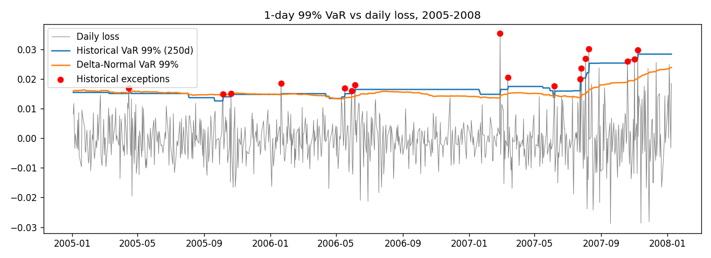

# Market Risk Framework: VaR, Expected Shortfall & Backtesting

A Python framework that estimates, backtests and stress-tests the market risk of an S&P 500 position, and shows where simple VaR models break down for options.

Built from an MSc risk-management exercise (University of Amsterdam) and extended in Python with a rolling backtest, statistical tests, Expected Shortfall, stress scenarios and an options example.

## What it does

1. **VaR and Expected Shortfall** (1-day and 10-day, 99%) for a position of $1,000 per index point on 8 Jan 2008, using Delta-Normal, Historical Simulation and Monte Carlo (50,000 draws).
2. **Rolling backtest** of 1-day 99% VaR over 759 trading days (Jan 2005 to Jan 2008), using a 250-day window, with the Kupiec proportion-of-failures test and Basel traffic-light zones.
3. **Stress scenarios**: worst historical 1-day and 10-day losses, index shocks of -5%, -10% and -20%, and a doubling of volatility.
4. **Options example**: a short at-the-money straddle priced with Black-Scholes, comparing Delta-Normal VaR with full-revaluation VaR.

## Results

### VaR and ES for the index position (USD, 99%)

| Method | VaR 1-day | ES 1-day | VaR 10-day | ES 10-day |
|---|---:|---:|---:|---:|
| Delta-Normal | 36,135 | 41,394 | 114,268 | 130,898 |
| Historical Simulation | 41,130 | 50,412 | 130,066 | 159,417 |
| Monte Carlo | 36,296 | 41,604 | 114,778 | 131,563 |

Historical Simulation gives the highest figures because the data have fat tails (excess kurtosis of about 2.5), which the normal distribution does not capture. The gap is widest for Expected Shortfall (50,412 against about 41,400). The Monte Carlo figure differs slightly from run to run because of random draws.

### Backtest (1-day 99% VaR, 759 days, 2005 to 8 Jan 2008)

| Method | Exceptions | Expected | Kupiec p-value | Decision (5%) | Exceptions, last 250 days | Basel zone |
|---|---:|---:|---:|---|---:|---|
| Historical Simulation (250d) | 17 | 7.6 | 0.003 | Reject | 10 | Red |
| Delta-Normal (250d) | 24 | 7.6 | < 0.001 | Reject | 17 | Red |



Both models are rejected. The exceptions cluster in 2007, which is consistent with a 250-day window reacting slowly to the rise in volatility that year. Delta-Normal performs worse than Historical Simulation because it ignores fat tails.

### Stress scenarios (linear index position, USD)

| Scenario | Loss |
|---|---:|
| Worst 1-day loss in sample (14 Apr 2000, -6.0%) | 83,474 |
| Worst 10-day loss in sample (window ending 23 Jul 2002, -17.8%) | 247,042 |
| Index -5% | 69,510 |
| Index -10% | 139,019 |
| Index -20% | 278,038 |

The worst historical 10-day loss is roughly twice the model 10-day VaR.

### Options example: short ATM straddle (1,000 units, 30 days)

| Measure | Value (USD) |
|---|---:|
| Delta-Normal 1-day VaR | 2,669 |
| Full-revaluation 1-day VaR | 14,318 |
| Full-revaluation 1-day ES | 20,775 |

The position is almost delta-neutral, so Delta-Normal sees almost no risk. Full revaluation shows a VaR about five times larger, because the real exposure is to large moves in either direction (gamma) and to volatility (vega):

| Scenario | P&L (USD) |
|---|---:|
| Index -10% | -79,004 |
| Index +10% | -88,851 |
| Volatility x2 | -56,151 |

## Method notes and assumptions

- Returns are daily log returns of the S&P 500 adjusted close, 3 Jan 2000 to 8 Jan 2008.
- Historical VaR in the backtest uses the previous 250 returns, lagged by one day so that no future information is used. The full-sample figures in the first table use all 2,014 returns.
- 10-day figures scale the 1-day figures by the square root of 10, which assumes independent returns.
- Kupiec test: likelihood-ratio test of the exception rate against 1%, chi-squared with one degree of freedom. Basel zones for 250 observations at 99%: green 0 to 4 exceptions, yellow 5 to 9, red 10 or more.
- Options example: Black-Scholes pricing, at-the-money strike (1,390), 30 days to expiry, 4% risk-free rate, and realised volatility (17.7% annualised) as the pricing volatility. Each historical one-day return is applied to the index and the straddle is fully revalued, with volatility held constant over the day. These inputs are assumptions chosen for illustration, not market quotes.
- The backtest tests an unconditional exception rate only. It does not test whether exceptions cluster over time.

## Limitations and next steps

- The dataset ends in January 2008, so it does not include the 2008 crisis. Extending the data and replaying the 2008 sell-off is a natural next step.
- Replace the equal-weighted 250-day window with an exponentially weighted or filtered historical simulation to test whether it adapts faster to volatility changes.
- Add a Christoffersen independence test.
- Build an interactive dashboard (Streamlit or Plotly) for exposures, VaR and exceptions.

## Repository contents

```
market_risk_var_backtest.ipynb   analysis notebook (outputs included)
data/sp500_2000_2008.csv         daily adjusted close and log returns
backtest.png                     VaR vs daily loss chart
requirements.txt                 numpy, pandas, scipy, matplotlib
```

## How to run

```
pip install -r requirements.txt
jupyter notebook market_risk_var_backtest.ipynb
```

Or open the notebook in Google Colab and upload `data/sp500_2000_2008.csv`.
